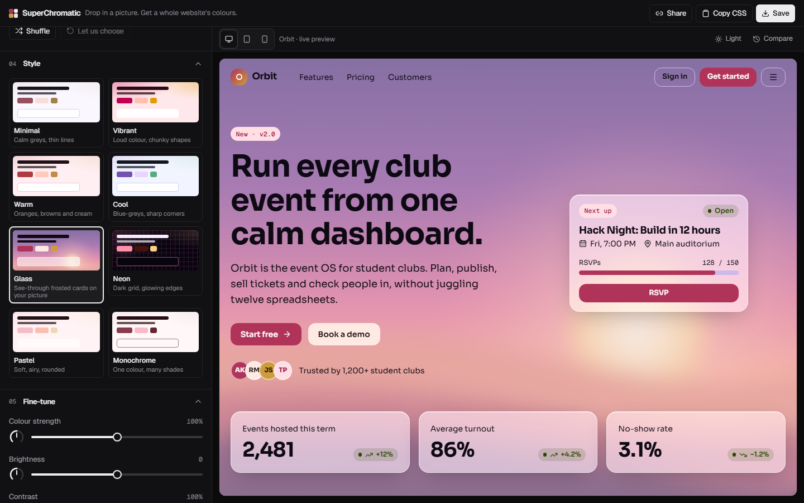
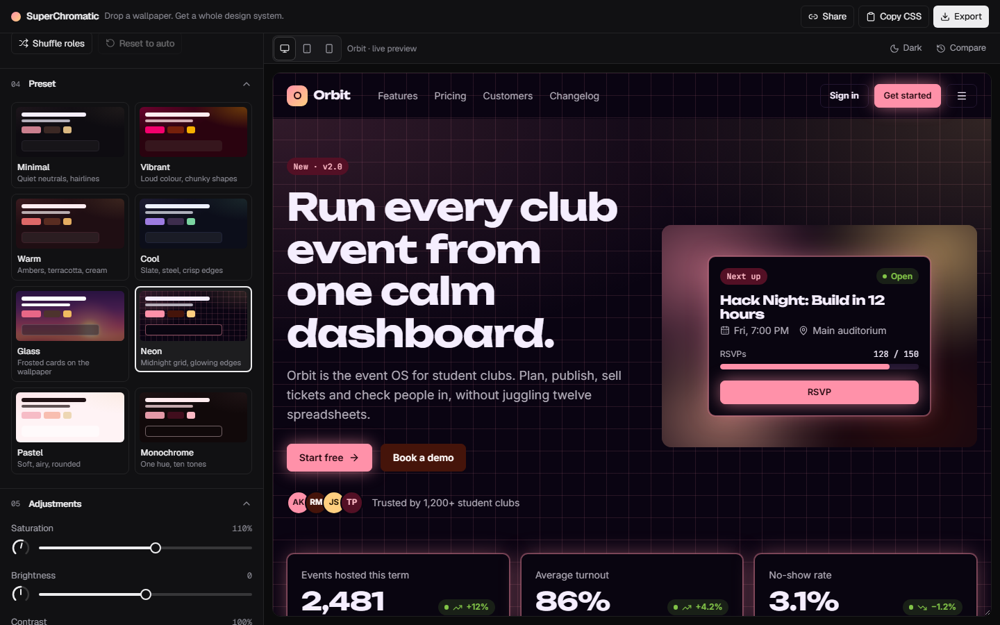
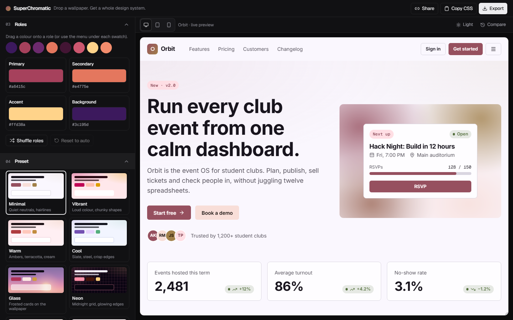
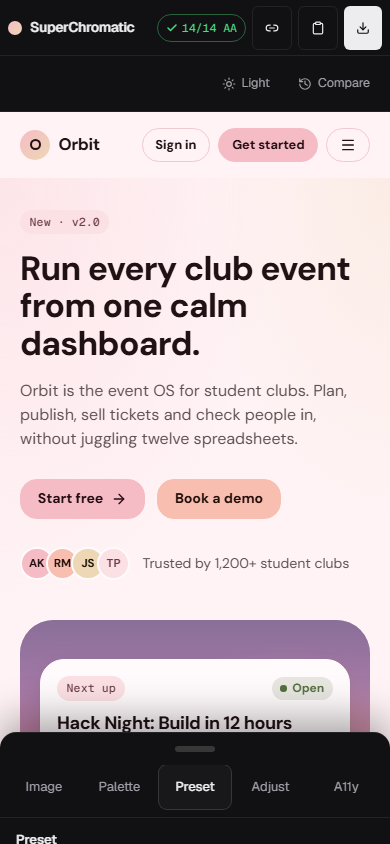
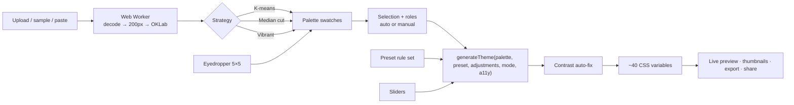

# SuperChromatic

**Drop a wallpaper. Get a whole design system.** SuperChromatic extracts a palette from any image, turns it into a complete, accessible theme (about 40 design tokens), and restyles a realistic product site live while you tweak it.

**Live demo:** _LIVE_URL_ · **Repo:** _REPO_URL_



| Neon | Minimal | Pastel (mobile) |
|---|---|---|
|  |  |  |

## Features (mapped to the brief)

**Requirements**
- ✅ **Image upload & colour extraction**: drag-and-drop, click to browse or paste (Ctrl+V); PNG/JPG/WebP up to 15 MB, with a friendly error for anything else. Extraction runs in a Web Worker. Click a swatch to choose whether it goes into the theme.
- ✅ **Theme presets**: 8 presets (Minimal, Vibrant, Warm, Cool, Glass, Neon, Pastel, Monochrome). Each one is a *rule set* applied to your palette, not a fixed set of colours, and each card shows a live thumbnail of the result.
- ✅ **Visual adjustments**: saturation, brightness, contrast, background blur, overlay opacity and corner radius. They update in real time, have dial visuals, and reset on double-click or Delete.
- ✅ **Live theme preview**: "Orbit", a fictional event-OS site with a navbar, hero, stats, feature grid, sign-up form, tabs, alert, progress, avatars, chips, tooltip, data table, pricing and footer. Every element is interactive.
- ✅ **Themed UI components**: H1 and secondary text, page and card backgrounds, card title and secondary text, primary and secondary buttons, inputs, select, textarea, checkbox, radio, switch and badges.
- ✅ **Theme consistency**: one pure function, `generateTheme()`, writes CSS variables. The preview contains no colour literals, and a unit test enforces this.
- ✅ **Responsive**: side-by-side panes at ≥1024px; a resizable left drawer from 640 to 1023px; under 640px the preview fills the screen and the controls live in a draggable bottom sheet (peek, half or full) with 44px touch targets. There is no horizontal scroll at any width (tested at 390, 768, 1024 and 1440px).

**Bonuses**
- ✅ **Multiple extraction strategies**: K-means (default), Median cut and Vibrant, plus an **eyedropper** on the image. It averages 5×5 pixels, shows a magnifier loupe on hover, and is keyboard-operable (arrow keys + Enter).
- ✅ **Accessibility-aware colours**: a WCAG 2.x contrast engine with auto-fix (on by default) and a 14-pair report showing AA/AAA badges and "fixed" markers. The top-bar chip reads e.g. "✓ 14/14 AA". Glass surfaces are checked against the worst case behind them.
- ✅ **Smooth transitions & micro-animations**: colour tokens are registered with `@property`, so the whole theme interpolates. Swatches stagger in and spring when selected. Role chips glide between slots (shared layout), the preset outline slides from card to card, slider thumbs grow while dragged, a scan line sweeps the image during extraction, and "Copy CSS" gives a sparkle burst. All of it switches off under `prefers-reduced-motion`.

**Extras**: export as CSS variables, JSON tokens or a Tailwind v4 `@theme` block (copy or download); a shareable URL that stores the palette, roles, preset, sliders and mode in the hash; the last session saved in localStorage; light/dark preview; desktop/tablet/mobile preview frames using container queries; hold-to-compare with the previous theme; 5 original sample wallpapers.

## Run it

```bash
npm i
npm run dev            # http://localhost:5173
npm run typecheck
npm run test           # vitest: colour maths, extraction, roles, generator, share URL, "no colour literals" guard
npm run build
npx playwright install chromium
npx playwright test    # smoke test + screenshots against `npm run preview`
```

## How it works



| Path | What lives there |
|---|---|
| `src/lib/extract/` | `pixels.ts` (sRGB→OKLab), `kmeans.ts`, `medianCut.ts`, `vibrant.ts`, `extract.worker.ts`, `client.ts` |
| `src/lib/theme/` | `oklch.ts` (colour helpers, gamut mapping), `roles.ts`, `presets.ts`, `adjust.ts`, `generate.ts`, `tokens.ts` |
| `src/lib/a11y/contrast.ts` | WCAG luminance/contrast, alpha blending, lightness auto-fix |
| `src/lib/share/` | URL hash encode/decode, CSS/JSON/Tailwind export |
| `src/store/useThemeStore.ts` | zustand store (persisted), `useTheme()` |
| `src/components/controls/` | Upload + eyedropper, palette, roles, presets, sliders, contrast report, export modal, bottom sheet |
| `src/preview/` | The Orbit site; `preview.css` uses only `var(--…)` |

## Colour extraction

**Why OKLab?** OKLab is perceptually uniform: equal distances look like equal differences. Clustering in RGB (or HSL) groups colours the eye sees as different and splits colours it sees as the same. In OKLab, plain Euclidean distance (ΔE_ok) is a good stand-in for "how different do these look", so every strategy works there.

**Pipeline** (inside a Web Worker, so the UI never blocks): `createImageBitmap` → draw onto an `OffscreenCanvas` with the longest side at 200px (≤ 40k pixels, which is plenty for a palette) → skip pixels with alpha < 125 → convert each pixel to OKLab with a precomputed sRGB-linearisation table and Ottosson's matrices.

1. **K-means (default).** k-means++ seeding with a seeded PRNG (mulberry32), so the same image always gives the same palette. Lloyd iterations (max 20 or until no pixel changes cluster). Clusters closer than ΔE_ok 0.04 are merged (they'd read as one colour), and results are sorted by population. k is adjustable from 5 to 10.
2. **Median cut.** Start with one box of all pixels. Repeatedly pick the box whose widest OKLab channel is widest overall, sort it along that channel and split at the median until there are k boxes. Each box's mean is a colour.
3. **Vibrant.** Bucket pixels by hue (12 × 30°) × lightness band (dark/mid/light), with greys in their own buckets. Score each colourful bucket by `chroma × √population`, so a small but vivid accent can beat a large dull area. Greedily keep the best buckets that are ≥ 0.08 apart, and always keep the dominant colour as an anchor for the background.

**Eyedropper.** The image is copied once into a ≤1024px canvas; a click averages a 5×5 block in OKLab (the same maths as extraction) and adds it as a `picked` swatch. Hovering shows a 6× loupe drawn with CSS `background-position`, with no extra canvas.

**Determinism.** A fixed seed plus deterministic iteration gives identical output for identical pixels. A unit test checks this.

## Theme generation

**Roles** (`roles.ts`). From the *selected* swatches: Background = most populous; Primary = highest `chroma × √population`; Accent = the colour whose hue is furthest from Primary (with chroma ≥ 0.05); Secondary = the next best score. Missing roles are derived from Primary by hue rotation in OKLCH (Secondary +30°, analogous; Accent +150°, split-complementary). Users can drag a swatch onto a role (pointer-based, so it works on touch) or use the role menu under each swatch. Shuffle and Reset are animated.

**Presets are rule sets** (`presets.ts`). Each preset sets, per light/dark mode: background lightness and maximum tint chroma, a lightness band and chroma scale/clamp for each role, an optional hue pull (Warm pulls hues toward 30–70°, Cool toward 200–260°, both at 65% weight so the image stays recognisable), card style, shadow, border, radius, fonts and default slider values. Monochrome snaps every role onto a 10-step tonal scale of Primary's hue. Glass makes the wallpaper itself the page. Neon adds a grid and glows. The same palette produces 8 visibly different themes.

**Adjustments** (`adjust.ts`) are applied *inside* the generator, so every token follows: saturation multiplies chroma; brightness shifts L (±0.15); contrast pushes surface and text lightness away from (or toward) the 0.5 midpoint; blur and overlay drive the wallpaper layer and glass cards; radius sets `--radius`.

**OKLCH all the way.** All decisions are made in OKLCH (lightness, chroma, hue), and only at the end is each colour gamut-mapped to sRGB with culori's `clampChroma`. That lowers chroma while keeping hue and lightness, so out-of-gamut colours keep their character instead of clipping.

**Tokens.** Surfaces `--bg --bg-gradient --surface --card --card-border --overlay` · text `--text --text-muted --text-subtle` · `--primary --primary-hover --primary-text` · `--secondary --secondary-hover --secondary-text` · `--accent --accent-text` · form `--border --input-bg --input-border --ring` · `--badge-bg --badge-text` · status `--success --warning --danger` (fixed semantic hues nudged 12% toward Primary) · effects `--shadow --button-shadow --glow --radius --blur --card-blur --overlay-opacity --card-alpha --border-width --bg-pattern` · fonts `--font-heading --font-body --font-mono`.

**Why one token source means consistency.** The preview never decides a colour. Every component reads `var(--…)` written by `generateTheme()`, so changing one swatch, preset or slider changes every button, card, input and badge together, and nothing can drift out of sync. `tests/theme.test.ts` fails the build if a colour literal (hex, `rgb()`, `oklch()`, a named colour or a Tailwind colour class) appears anywhere in `src/preview/`.

**Smooth changes.** All 26 colour tokens are registered with CSS `@property { syntax: '<color>' }`, so the browser can interpolate them. The preview root transitions them over 350ms, and gradients built from `var(--primary)` animate too.

## Accessibility

- **WCAG maths** (`contrast.ts`): relative luminance from linearised sRGB (0.2126 R + 0.7152 G + 0.0722 B) and the ratio `(L1 + 0.05) / (L2 + 0.05)`. Tests check #000/#fff = 21 and #777/#fff ≈ 4.48.
- **Auto-fix** (on by default): for each failing foreground, keep its hue and chroma and move only its OKLCH lightness. Both directions (toward black and toward white) are tried: a coarse scan brackets the first passing lightness, then a binary search narrows to the smallest change, and the direction needing the least change wins. Contrast is always measured on the *rendered* colour (gamut-mapped and rounded to hex), so a "pass" is real. A fuzz test checks the fix always ends ≥ target.
- **Targets**: 4.5:1 for text (body, muted, button labels, badges, input text, error/success/warning text) and 3:1 for input borders and focus rings. One `--text` token is fixed against the page, cards *and* inputs at once, because it is used on all of them.
- **Glass worst case**: translucent layers are composited (in sRGB, like the browser) over the overlay-tinted wallpaper's **darkest and lightest** extracted colours, and the worse result counts. If no text lightness can pass, the fixer raises the overlay opacity / card alpha in 5% steps until one can, and the report marks that pair "fixed".
- **Report panel**: every pair with its ratio, an AA/AAA/Fail badge, an "Aa" sample and a wrench marker if auto-fix changed it. The summary chip sits in the top bar.
- **The app itself**: native `<details>`, `<dialog>`, range inputs and selects for free keyboard support; visible focus rings; labels and ARIA on every control; an eyedropper that works by keyboard; the preview's native controls follow the theme's `color-scheme`; `prefers-reduced-motion` turns off every animation.

## Design decisions

- **Neutral studio chrome** (#0B0B0C, 1px hairlines, Geist + Geist Mono) so the user's theme is the star. The only themed pixel in the chrome is the wordmark dot (Primary → Accent). The chrome follows the system light/dark preference.
- **Fonts per preset**: Inter (Minimal: neutral), Space Grotesk (Vibrant: punchy), Fraunces (Warm: soft serif), Manrope (Cool: engineered), Sora (Glass: airy geometric), Unbounded + JetBrains Mono (Neon: loud display + techy labels), DM Sans (Pastel: friendly), IBM Plex Sans (Monochrome: sober).
- **Wallpaper band**: every non-Glass preset shows the wallpaper behind the hero's event card, so the blur and overlay sliders always do something visible.
- **Mobile bottom sheet** with tabs instead of a long scrolling panel, so the preview stays visible while you tweak it.
- **Performance**: extraction in a Worker on a 200px copy; the eyedropper samples a cached canvas; preset thumbnails use `useDeferredValue` so they never slow the main preview.
- **Determinism**: the same image always gives the same palette, which matters for share links and demos.

## Limitations & future work

- Share links don't include the wallpaper (URLs can't hold images); a palette gradient stands in for it. Uploaded images aren't kept across reloads either (sample images are).
- Glass contrast uses the extracted extremes, not every pixel. A blurred wallpaper usually sits within that range, but a tiny very bright highlight could fall outside it.
- Contrast uses WCAG 2.x. APCA (WCAG 3 draft) would judge thin and large text better.
- Future: export to Figma variables, more preview templates (dashboard, mobile app), a palette history.

## Credits

Libraries: React, Vite, TypeScript, Tailwind CSS v4, culori (colour-space conversions and gamut mapping), zustand, Motion, lucide-react, Vitest, Playwright. Fonts from Google Fonts. **The 5 sample wallpapers were generated procedurally for this project** (`scripts/render-samples.mjs`, SVG sources in `scripts/samples/`). "Orbit" is a fictional product.
