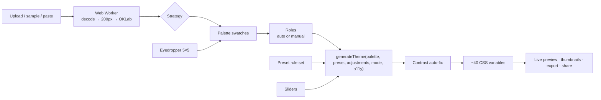

# SuperChromatic

**Drop a wallpaper. Get a whole design system.** SuperChromatic pulls a palette from any image, turns it into an accessible theme of about 40 design tokens, and restyles a realistic product site live while you tweak it.

**Live demo:** https://superchromatic.vercel.app · **Repo:** https://github.com/Adiiiiiiiiiiithegoat/superchromatic


| Neon | Minimal | Pastel (mobile) |
|---|---|---|
|  |  |  |

## Features (mapped to the brief)

**Requirements**
- ✅ **Image upload & colour extraction**: drag-and-drop, browse or paste (Ctrl+V); PNG/JPG/WebP up to 15 MB. Extraction runs in a Web Worker. Click a swatch to include or exclude it.
- ✅ **Theme presets**: Minimal, Vibrant, Warm, Cool, Glass, Neon, Pastel and Monochrome. Each is a *rule set* applied to your palette, not fixed colours, and each card shows a live thumbnail.
- ✅ **Visual adjustments**: saturation, brightness, contrast, background blur, overlay opacity and corner radius, all live. Double-click or Delete resets one.
- ✅ **Live theme preview**: "Orbit", a fictional event-OS site with navbar, hero, stats, features, form, tabs, alert, table, pricing and footer. Its links and buttons work.
- ✅ **Themed UI components**: headings and body text, page and card backgrounds, buttons, inputs, select, textarea, checkbox, radio, switch and badges.
- ✅ **Theme consistency**: one pure function, `generateTheme()`, writes CSS variables. The preview has no colour literals, and a unit test enforces it.
- ✅ **Responsive**: side by side from 1024px, a resizable drawer from 640px, and a draggable bottom sheet on phones. No horizontal scroll at 390, 768, 1024 or 1440px.

**Bonuses**
- ✅ **Multiple extraction strategies**: six colour styles (Natural, Varied, Vibrant, Rainbow, Matching, Soft), each explained in one line. No colour family covering 3%+ of the picture goes missing. Plus a keyboard-operable **eyedropper** with a magnifier loupe.
- ✅ **Accessibility-aware colours**: a WCAG contrast engine with auto-fix (on by default) and a 14-pair report in plain words ("Great" / "Good" / "Hard to read"). Glass surfaces are checked against the worst case behind them.
- ✅ **Smooth transitions & micro-animations**: colour tokens are registered with `@property`, so the whole theme fades between states. Swatches, role chips, preset outlines and sliders animate. All of it turns off under `prefers-reduced-motion`.

**Extras**: export as CSS variables, JSON or a Tailwind v4 `@theme` block; share links; the last session and recent uploads are remembered; light/dark preview; desktop/tablet/mobile frames; hold-to-compare; 5 original sample wallpapers.

## Run it

```bash
npm i
npm run dev            # http://localhost:5173
npm run typecheck
npm run test           # vitest
npm run build
npx playwright install chromium
npx playwright test    # smoke test + screenshots against `npm run preview`
```

## How it works



| Path | What lives there |
|---|---|
| `src/lib/extract/` | sRGB→OKLab, k-means, median cut, vibrant, mood strategies, the worker |
| `src/lib/theme/` | colour helpers, roles, presets, adjustments, `generateTheme()` |
| `src/lib/a11y/contrast.ts` | WCAG contrast, alpha blending, lightness auto-fix |
| `src/lib/share/` | share-URL encoding, CSS/JSON/Tailwind export |
| `src/store/useThemeStore.ts` | zustand store (persisted) |
| `src/components/controls/` | the control panel |
| `src/preview/` | the Orbit site; `preview.css` uses only `var(--…)` |

## Colour extraction

**Why OKLab?** It is perceptually uniform: equal distances look like equal differences. Clustering in RGB or HSL groups colours the eye sees as different and splits ones it sees as the same.

**Pipeline** (in a Web Worker): decode → scale the longest side to 200px → skip mostly transparent pixels → convert to OKLab.

1. **K-means ("Natural", default).** Seeded k-means++, so the same image always gives the same palette. Clusters closer than ΔE_ok 0.04 merge. k is adjustable from 5 to 10.
2. **Median cut ("Varied").** Repeatedly split the box with the widest OKLab channel at its median until there are k boxes.
3. **Vibrant ("Vibrant").** Bucket pixels by hue and lightness, score by `chroma × √population` so a small vivid accent can beat a big dull area, and keep the best buckets that are far enough apart.

Three "mood" strategies (`moods.ts`) change *which* colours are picked: **Rainbow** (one colour per hue family, round the wheel), **Matching** (shades of the main family) and **Soft** (the quieter, dusty colours).

**No missing colour families.** Any hue family covering at least 3% of the picture but missing from the palette replaces the most redundant swatch. Without this, a dark navy could get folded into the blacks.

**Eyedropper.** A click averages a 5×5 block in OKLab, the same maths as extraction. The hover loupe is plain CSS `background-position`.

## Theme generation

**Roles.** Background = most common colour; Primary = highest `chroma × √population`; Accent = furthest hue from Primary; Secondary = next best. Missing roles are derived from Primary by hue rotation. You can drag swatches onto roles or use the menu under each one.

**Presets are rule sets.** Each sets, per mode, background lightness and tint, lightness and chroma limits for each role, an optional hue pull (Warm, Cool), card, shadow and border styles, fonts and slider defaults. The same palette produces 8 visibly different themes.

**Adjustments** run *inside* the generator, so every token follows them.

**OKLCH all the way.** Every decision is made in OKLCH; only at the end is each colour gamut-mapped to sRGB (culori's `clampChroma`), which lowers chroma while keeping hue and lightness.

**One token source.** The preview never picks a colour; every component reads `var(--…)` from `generateTheme()`, so nothing can drift out of sync. `tests/theme.test.ts` fails if a colour literal appears in `src/preview/`.

## Accessibility

- **WCAG 2.x maths** in `contrast.ts`, tested against known ratios (#000/#fff = 21).
- **Auto-fix**: a failing colour keeps its hue and chroma and moves only its lightness, by the smallest amount that passes. Contrast is measured on the final rendered hex, so a pass is real. A fuzz test checks it.
- **Targets**: 4.5:1 for text, 3:1 for input borders and focus rings.
- **Glass**: translucent layers are checked over the wallpaper's darkest and lightest colours; if no text can pass, the overlay gets more opaque until it does.
- **Report**: each pair shows its ratio, a grade, an "Aa" sample and an "Adjusted" tag if auto-fix changed it.
- **The app itself**: native controls, visible focus rings, labels and ARIA everywhere, a keyboard eyedropper, and reduced-motion support.

## Plain language

The controls avoid jargon so anyone can use them; the code keeps the technical names.

| In the code | On screen |
|---|---|
| Wallpaper / Palette / Roles / Preset / Adjustments / Accessibility | Picture / Colours / Where each colour goes / Style / Fine-tune / Easy to read |
| Primary / Secondary / Accent | Main / Second / Highlight |
| AAA / AA / Fail | Great / Good / Hard to read |

## Persistence

Settings are saved to localStorage. Uploaded images go into IndexedDB with their palettes (the 5 newest), so a reload brings back exactly what you had without re-extracting. If storage is unavailable, the app still works; it just doesn't remember.

## Design decisions

- **Neutral studio chrome** so the user's theme is the star.
- **A font per preset**: Inter, Space Grotesk, Fraunces, Manrope, Sora, Unbounded, DM Sans, IBM Plex Sans.
- **Mobile bottom sheet** instead of a long panel, so the preview stays visible.
- **Performance**: colours animate once on the preview root, sliders drive the preview directly while held, extraction runs on a 200px copy in a Worker, and preset thumbnails are deferred.
- **Determinism**: the same image always gives the same palette, which keeps share links and demos stable.

## Limitations & future work

- Share links don't include the wallpaper (URLs can't hold images).
- Glass contrast uses the extracted extremes, not every pixel.
- WCAG 2.x, not APCA, which would judge thin and large text better.
- Future: Figma variables export, more preview templates, palette history.

## Credits

React, Vite, TypeScript, Tailwind CSS v4, culori, zustand, Motion, lucide-react, Vitest, Playwright; fonts from Google Fonts. **The 5 sample wallpapers were generated procedurally for this project** (`scripts/render-samples.mjs`). "Orbit" is a fictional product.
